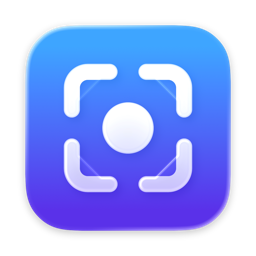

# Shot

macOS 選單列截圖工具。這個 repo 放的是簽章並經 Apple 公證的安裝檔與自動更新資訊，原始碼不公開。

[English](#english)

## 下載與安裝

1. 到 [Releases](https://github.com/chung223/shot-releases/releases/latest) 下載最新的 `Shot-<版本>.dmg`。
2. 打開 DMG，把 Shot 拖進「應用程式」。
3. 打開 Shot。第一次會出現歡迎視窗，帶你開啟「螢幕錄製」權限（截圖一定要有）。

需要 macOS 26 以上，Apple 晶片與 Intel 的 Mac 都可以。Shot 住在選單列，沒有 Dock 圖示。

## 曬衣繩

截圖之後，照片會從原本的位置飛到螢幕頂端的一條繩子上，用夾子夾著輕輕搖晃。

- 按一下拷貝、按兩下打開、直接拖進其他 App；右鍵還能釘選、標註、擷取文字、上傳。
- 滑鼠離開後繩子收回選單列上方，游標推到螢幕最上緣停一下就會再滑下來。
- 不只截圖：拖著檔案、圖片、文字或網址靠近螢幕頂端，繩子會放下來接住；在任何地方拖著東西左右搖幾下，游標底下也會掉下一段繩子。一次拖好幾個檔案會收成一疊，拖出去時一起帶走。
- 不喜歡的話，設定裡可以改成螢幕角落的卡片。

曬衣繩的點子來自開源專案 [Tendedero](https://github.com/alejandrobujan/tendedero)（MIT 授權），Shot 依自己的架構重新實作。

## 功能

- **截圖**：區域、視窗、全螢幕、上次的區域；捲動截圖自動拼成長圖。選範圍時按 R 重拍底下的畫面、按 , . 叫出之前截過的範圍、用滾輪選視窗裡的按鈕或側邊欄。可以包含游標；存成 PNG、JPEG、HEIC 或 AVIF。
- **標註**：箭頭（可以彎、可以黏住框跟著移動）、文字與對話框、形狀、步驟編號（1 2 3、A B C、羅馬數字，刪掉自動補號）、螢光筆（劃過文字自動對齊成整齊的螢光條）、放大鏡、尺規、取色、智慧橡皮擦、自動遮蔽 email 與金鑰等敏感資訊、剪掉長截圖的中段、背景美化、手繪風。畫到圖片外面時畫布自動擴大；自動存草稿，關掉也找得回來。
- **釘選**：把截圖釘在螢幕最上層；拖到另一張旁邊會吸在一起拼成一張。即時釘選可以釘住一塊持續更新的畫面（看 log、進度條或影片）。
- **錄影與 GIF**：可以顯示按鍵、高亮游標、在角落放鏡頭畫面；內建剪輯器修剪頭尾、去掉聲音、轉 GIF。
- **文字**：辨識截圖裡的文字與 QR code；擷取表格（貼到試算表是一格一格的，貼到文字編輯器是 Markdown 表格）；直接翻譯截圖；把照片裡的主體做成去背貼紙。
- **截圖歷史**：用畫面裡的字搜尋以前的截圖，Apple Intelligence 自動取標題。
- **給 AI agent**：附一支命令列工具，也是 MCP 伺服器，讓 Claude Code 之類的 agent 搜尋你的截圖、讀文字與表格；開啟後也能請 Shot 代拍（預設關閉）。安裝指令在「設定 › AI 與命令列」。
- **上傳**：上傳到自己的 Cloudflare R2、S3 相容服務（AWS S3、Backblaze B2、MinIO…）或任何圖床（可以匯入 ShareX 的設定檔），並拷貝連結。
- **其他**：取色與量測、捷徑 App 與 Spotlight 動作。

介面有繁體中文與英文，跟著系統語言切換。

## 更新

Shot 會自動檢查新版本，有新版時會提醒你，按一下就下載安裝。也可以從選單列的「檢查更新…」手動檢查。

## 隱私

- 截圖、文字與表格辨識、翻譯、AI 命名都在你的 Mac 上處理，不會上傳。
- 沒有使用統計，也沒有追蹤。
- 只有兩種情況會連上網路：檢查更新（連到這個 GitHub repo），以及你自己設定好上傳目的地之後的上傳。上傳用的金鑰只存在 macOS 鑰匙圈。

## 回報問題

到 [Issues](https://github.com/chung223/shot-releases/issues) 開一則，附上 macOS 版本與 Shot 版本（設定 › 一般 最下面）。

---

## English

Shot is a menu bar screenshot tool for macOS. This repository hosts signed, Apple-notarized builds and update information; the source code is not public.

**Install:** download the latest `Shot-<version>.dmg` from [Releases](https://github.com/chung223/shot-releases/releases/latest), open it and drag Shot into Applications. Requires macOS 26 or later, on Apple silicon or Intel. On first launch, a welcome window helps you allow Screen Recording, which screenshots require.

**The clothesline:** after you take a screenshot, it flies up to a clothesline at the top of the screen and hangs there from a clip. Click to copy, double-click to open, or drag it straight into another app. The line tucks away above the menu bar and slides back down when you push the pointer to the top edge. It also takes other things: drag files, images, text or links near the top of the screen and the line drops down to catch them, or shake anything you're dragging to drop a line right under the pointer. Several files at once become a stack. Prefer something quieter? Switch to corner cards in Settings. The clothesline idea comes from the open-source [Tendedero](https://github.com/alejandrobujan/tendedero) (MIT), reimplemented for Shot.

**Features:**

- **Capture:** area, window, full screen, last area and scrolling capture. While selecting, press R to retake the frozen screen, , and . to bring back earlier areas, or scroll to select buttons and sidebars inside a window. Optionally include the pointer; save as PNG, JPEG, HEIC or AVIF.
- **Annotate:** arrows that bend and stick to shapes, text and callouts, shapes, numbered steps (1 2 3, A B C or Roman numerals, renumbered when you delete one), a highlighter that snaps to lines of text, a magnifier, rulers, color picking, a smart eraser, automatic redaction of emails and keys, cutting the middle out of long screenshots, backgrounds and a hand-drawn look. The canvas grows when you draw past the edge, and drafts are saved so closing the window never loses your work.
- **Pin:** pin screenshots above everything; drag one next to another and they snap together into one. Live pins keep a region of the screen updating, for watching logs, progress bars or videos.
- **Record:** screen recordings and GIFs with keystrokes, cursor highlight and a camera bubble, plus a built-in trimmer.
- **Text:** recognize text and QR codes; capture tables that paste as real cells into spreadsheets or as Markdown into text editors; translate screenshots; turn a photo's subject into a sticker.
- **History:** search past screenshots by the text in them, with titles from Apple Intelligence.
- **For AI agents:** a command-line tool that is also an MCP server, so agents like Claude Code can search your screenshots and read text and tables; it can also ask Shot to take screenshots if you allow it (off by default). Find the install command in Settings › AI & Command Line.
- **Upload:** to your own Cloudflare R2, any S3-compatible storage (AWS S3, Backblaze B2, MinIO…) or any image host (ShareX config files can be imported), with the link copied for you.
- **More:** color picking and measuring, Shortcuts and Spotlight actions.

The interface is available in English and Traditional Chinese.

**Updates:** Shot checks for updates automatically, or choose Check for Updates… from the menu bar.

**Privacy:** screenshots, text and table recognition, translation and AI naming all run on your Mac. There are no analytics or tracking. Shot only goes online to check for updates (this GitHub repository) and to upload to the destination you set up; upload keys stay in the macOS keychain.

**Feedback:** open an [issue](https://github.com/chung223/shot-releases/issues) with your macOS and Shot versions (shown at the bottom of Settings › General).
